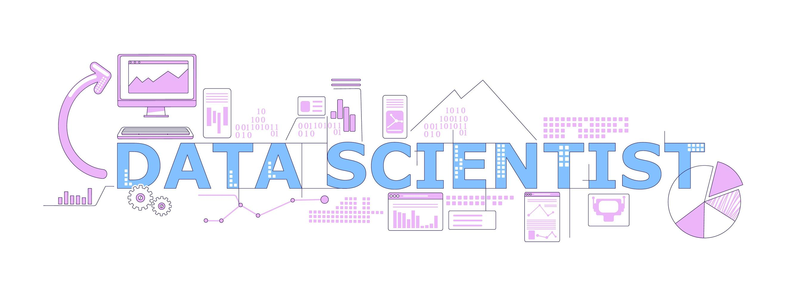

<p align="center">
  
</p>

<h1 align="center">Hi, I'm Lucky Singh 👋</h1>

<h3 align="center">
  Data Scientist | Machine Learning | Deep Learning | Generative AI
</h3>

<p align="center">
  Building data-driven solutions that turn raw data into meaningful insights,
  predictive models, and intelligent applications.
</p>

<p align="center">
  <a href="https://www.linkedin.com/in/lucky-singh-7153b517b/">
    
  </a>
  <a href="mailto:rajputlucky575@gmail.com">
    
  </a>
</p>

---

## 👨‍💻 About Me

I'm a Data Science practitioner focused on building practical, end-to-end
solutions using data, machine learning, and AI.

I enjoy working across the complete data science workflow:

- 📊 Exploratory Data Analysis & Data Visualization
- 🧹 Data Cleaning & Feature Engineering
- 🤖 Supervised & Unsupervised Machine Learning
- 🧠 Deep Learning
- 🗣️ NLP & Generative AI
- 🔎 RAG & LLM Applications
- ⚙️ AI Agents
- 🚀 Model Deployment & APIs

My goal is to build projects that go beyond notebooks and demonstrate how
machine learning can solve real-world problems.

---

## 🚀 Featured Projects

### 1. End-to-End Machine Learning Project
**Problem:** [Add your business problem]

**Tech:** Python • Pandas • Scikit-learn • XGBoost • MLflow

- Performed data cleaning and exploratory analysis
- Engineered features for model development
- Compared multiple machine learning algorithms
- Used cross-validation and hyperparameter tuning
- Evaluated models using appropriate business metrics
- Built a reusable prediction pipeline

🔗 **[View Project](YOUR_REPOSITORY_LINK)**

---

### 2. Customer Segmentation & Unsupervised Learning

**Tech:** Python • Pandas • Scikit-learn • K-Means • PCA

- Performed exploratory analysis on customer behavior
- Applied feature scaling and dimensionality reduction
- Compared clustering approaches
- Identified meaningful customer segments
- Translated clusters into actionable business insights

🔗 **[View Project](YOUR_REPOSITORY_LINK)**

---

### 3. Time Series Forecasting

**Tech:** Python • Pandas • NumPy • Matplotlib • Scikit-learn

- Analyzed historical time-series patterns
- Performed trend and seasonality analysis
- Created forecasting features
- Compared forecasting approaches
- Evaluated predictions using appropriate time-series metrics

🔗 **[View Project](YOUR_REPOSITORY_LINK)**

---

### 4. Generative AI / RAG Application

**Tech:** Python • LangChain • LLMs • RAG • Vector Database • FastAPI

- Built a retrieval-augmented generation pipeline
- Implemented document ingestion and chunking
- Generated embeddings and performed semantic retrieval
- Connected retrieved context with an LLM
- Designed the application around a real-world use case

🔗 **[View Project](YOUR_REPOSITORY_LINK)**

---

## 🛠️ Technical Skills

### Programming & Data

<p>

</p>

**Python:** Pandas • NumPy • Scikit-learn • Matplotlib • Seaborn

### Machine Learning

- Regression
- Classification
- Clustering
- Feature Engineering
- Feature Selection
- Model Evaluation
- Cross-Validation
- Hyperparameter Optimization
- Ensemble Learning

### Deep Learning & AI

<p>

</p>

- Neural Networks
- Deep Learning
- NLP
- Generative AI
- LLM Applications
- RAG
- AI Agents

### Tools & Development

<p>

</p>

- Git & GitHub
- Jupyter Notebook
- REST APIs
- FastAPI
- Streamlit

---

## 📈 My Data Science Workflow

```text
Problem Definition
        ↓
Data Collection
        ↓
Data Cleaning
        ↓
Exploratory Data Analysis
        ↓
Feature Engineering
        ↓
Model Development
        ↓
Model Evaluation
        ↓
Error Analysis
        ↓
Deployment
        ↓
Monitoring & Improvement
