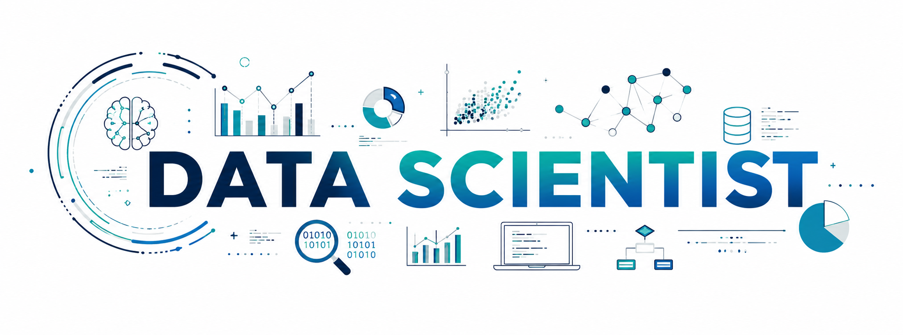

<p align="center">
  
</p>

<h1 align="center">Hi, I'm Lucky Singh 👋</h1>

<h3 align="center">
Data Scientist | Machine Learning | Deep Learning | Generative AI
</h3>

<p align="center">
Building practical, end-to-end data and AI solutions that turn data into
insights, predictions, and intelligent applications.
</p>

<p align="center">
  <a href="https://www.linkedin.com/in/lucky-singh-7153b517b/">
    
  </a>
  <a href="mailto:rajputlucky575@gmail.com">
    
  </a>
</p>

---

# 👨‍💻 About Me

I'm a Data Science practitioner focused on building practical,
end-to-end solutions using data, machine learning, and AI.

My work covers the complete data science lifecycle — from understanding
a business problem and preparing raw data to building, evaluating,
and deploying machine learning and AI solutions.

### What I work with

- 📊 Exploratory Data Analysis & Data Visualization
- 🧹 Data Cleaning & Feature Engineering
- 🤖 Supervised Machine Learning
- 🔍 Unsupervised Machine Learning
- 🧠 Deep Learning
- 🗣️ NLP & Generative AI
- 📚 RAG & LLM Applications
- 🤖 AI Agents
- 🚀 Model Deployment & APIs
- 🛠️ Git & GitHub

I enjoy solving real-world problems and continuously improving my
understanding of data, machine learning, and artificial intelligence.

---

# 🎯 My Data Science Approach

```text
Business Problem
       ↓
Data Collection
       ↓
Data Understanding
       ↓
Data Cleaning
       ↓
Exploratory Data Analysis
       ↓
Feature Engineering
       ↓
Model Development
       ↓
Model Evaluation
       ↓
Error Analysis
       ↓
Deployment
       ↓
Monitoring & Improvement
